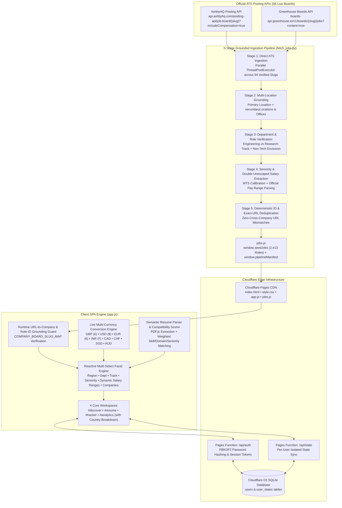
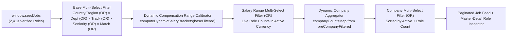

# AuraTrack AI — System Architecture & Grounded ATS Pipeline

**AuraTrack AI** is a frontier AI and high-compensation engineering career intelligence platform deployed on **Cloudflare Pages**, **Cloudflare Pages Functions**, and **Cloudflare D1**. It aggregates, grounds, and verifies **2,400+ live software, systems, and AI/ML engineering roles** across **94 official Ashby and Greenhouse ATS job boards** (including 50+ top high-paying UK / London startups, AI labs, and fintech scaleups).

---

## 1. High-Level System Architecture

---

## 2. The 5-Stage Grounded ATS Pipeline (`fetch_jobs.py`)

Every job card on AuraTrack AI is grounded directly against its official ATS posting via a deterministic 5-stage pipeline:

### Stage 1: Direct Official ATS Ingestion (94 Verified Boards)
- Queries official **Ashby** (`https://api.ashbyhq.com/posting-api/job-board/{slug}?includeCompensation=true`) and **Greenhouse** (`https://boards-api.greenhouse.io/v1/boards/{slug}/jobs?content=true`) endpoints concurrently.
- Covers **34 Frontier AI Labs** (`OpenAI`, `Anthropic`, `Reflection AI`, `xAI`, `Sierra`, `Anysphere/Cursor`, `Perplexity AI`, `Cohere`, `Wayve`, `Isomorphic Labs`, `ElevenLabs`, `Cognition`, `Physical Intelligence`, `Cerebras`, `Scale AI`, `Poolside`, `World Labs`, `Prime Intellect`, `Together AI`, `Baseten`, `Modal`, `LangChain`, etc.) plus **60+ high-paying UK / London & Global startups and scaleups** (`Monzo`, `Deliveroo`, `Graphcore`, `Faculty`, `Synthesia`, `incident.io`, `PhysicsX`, `Helsing`, `ClickHouse`, `Lovable`, `H Company`, `Reka AI`, `Latent Labs`, `Attio`, `Granola`, `Quantexa`, `Paddle`, `OakNorth`, `Speechmatics`, `GoCardless`, `Form3`, `Tide`, `Griffin`, `Plain`, `Sequence`, `Codat`, `PostHog`, `Stripe`, `Cloudflare`, `Elastic`, `Datadog`, `Vercel`, `Tailscale`, `Grafana Labs`, `Intercom`, etc.).

### Stage 2: Multi-Location Grounding (`secondaryLocations` & `offices`)
- Multi-hub postings frequently list `New York, NY` or `San Francisco, CA` as their primary location while placing `London, UK` or European hubs in `secondaryLocations` (Ashby) or `offices` (Greenhouse).
- `extract_ashby_locations()` and `extract_greenhouse_locations()` combine and deduplicate all primary and secondary offices into `"New York, NY • San Francisco, CA • London"`, ensuring 100% recall when filtering by **🇬🇧 UK / London**, **🇺🇸 SF / US**, **🇪🇺 Europe**, **🇨🇦 Canada**, or **🌐 Remote**.

### Stage 3: Department & Technical Role Verification
- Preserves raw ATS `department` and `team` metadata and normalizes each role into `deptTrack` (`"Engineering"` vs `"Research"`).
- Filters out non-engineering departments (`Legal`, `Finance`, `People/HR`, `Marketing`, `Sales/Commercial`, `IT Support`, `Security/GRC`, `Real Estate`) while retaining 100% of software, systems, infrastructure, ML, and research roles (for example, all **9 Reflection AI Engineering department roles** and **15 Research MTS roles**).

### Stage 4: Seniority Calibration & Double-Unescaped Compensation Extraction
- **Seniority Calibration**: Strips `"member of technical staff"` before checking standalone `"staff"` so IC `Member of Technical Staff (MTS)` roles are classified as `Senior / MTS` (`"Senior"`) while `Staff Engineer` and `Engineering Lead` roles are classified as `"Staff / Lead"`.
- **Official Compensation Extraction**: Double-unescapes Greenhouse HTML (`html.unescape(html.unescape(raw_html))`) so double-encoded entities (`&amp;mdash;` -> `—`) inside `
` are accurately parsed alongside Ashby `summaryComponents` and `scrapeableCompensationSalarySummary`.

### Stage 5: Deterministic ID & URL Integrity Verification
- Every job ID is deterministically scoped as `{board_slug}-{raw_ats_id}` and linked strictly to its exact role URL (`https://jobs.ashbyhq.com/{slug}/{id}` or `https://boards.greenhouse.io/{slug}/jobs/{id}`).
- Both build-time verification (`validate_and_deduplicate_jobs`) and runtime verification (`COMPANY_BOARD_SLUG_MAP` in `app.js`) guarantee **zero duplicate IDs** and **zero cross-company URL mismatches**.

---

## 3. Reactive Multi-Select Filter & Dynamic Range Architecture

- **True Multi-Selection Across Every Facet**: Users can select multiple options simultaneously within **Country / Region**, **ATS Department**, **Engineering Track**, **Seniority & Match**, **Compensation Ranges in Results**, and **Companies in Results** (union `OR` within each facet; intersection `AND` across facets).
- **Dynamic Results-Based Compensation Ranges**: Instead of static thresholds, compensation brackets are dynamically calibrated from the distribution of matching roles and converted live into the user's selected currency (`GBP £`, `USD $`, `EUR €`, `INR ₹`, `CAD C$`, `CHF`, `SGD`, `AUD`).
- **Country-Aware Market & Gaps Intelligence (`#analytics`)**: Provides multi-select country filtering (`🇬🇧 United Kingdom`, `🇺🇸 United States`, `🇪🇺 Europe`, `🇨🇦 Canada`, `🌐 Global Remote`) and a dedicated **Country & Tech Hub Compensation & Hiring Breakdown** card.

---

## 4. Multi-User Privacy & Cloudflare D1 Persistence

- **Guest Isolation**: New visitors start in a clean guest session (`usr_guest`) with zero leaked personal resume or application tracker data.
- **Authenticated Cloud Sync**: Signed-in users authenticate via `/api/auth` (Cloudflare Pages Function backed by D1 `users` table) and sync their private resume, custom roles, and Kanban application pipeline via `/api/state` (`user_states` table, keyed by `user_id` and verified session token).
