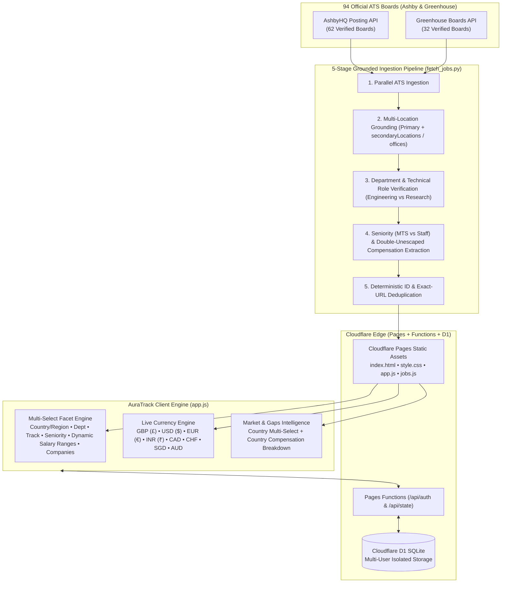

# AuraTrack AI 🚀
### Frontier AI & High-Compensation Startup Career Intelligence, Grounded ATS Aggregator & Resume Matcher

**Live Production**: [https://auratrack.pages.dev/#discover](https://auratrack.pages.dev/#discover)  
**Detailed System Architecture**: [ARCHITECTURE.md](./ARCHITECTURE.md)

AuraTrack AI aggregates, grounds, and verifies **2,413+ live software, systems, infrastructure, and AI/ML engineering roles** across **94 official Ashby and Greenhouse ATS job boards** — including **34 Frontier AI Labs** (`OpenAI`, `Anthropic`, `Reflection AI`, `xAI`, `Sierra`, `Anysphere/Cursor`, `Perplexity AI`, `Cohere`, `Wayve`, `Isomorphic Labs`, `ElevenLabs`, `Cognition`, `Physical Intelligence`, `Cerebras`, `Scale AI`, `World Labs`, `Prime Intellect`, `Together AI`, `Baseten`, `Modal`) and **60+ top high-paying UK / London & Global startups and scaleups** (`Monzo`, `Deliveroo`, `Graphcore`, `Faculty`, `Synthesia`, `incident.io`, `PhysicsX`, `Helsing`, `ClickHouse`, `Lovable`, `H Company`, `Reka AI`, `Latent Labs`, `Attio`, `Granola`, `Quantexa`, `Paddle`, `OakNorth`, `Speechmatics`, `GoCardless`, `Form3`, `Tide`, `Griffin`, `Plain`, `Sequence`, `Codat`, `PostHog`, `Stripe`, `Cloudflare`, `Elastic`, `Datadog`, `Vercel`, `Tailscale`, `Grafana Labs`, `Intercom`).

---

## 🏗️ System Architecture Overview

See [**ARCHITECTURE.md**](./ARCHITECTURE.md) for the complete technical specification.



---

## ✨ Key Capabilities

1. **5-Stage Grounded ATS Pipeline (`fetch_jobs.py`)**:
   - **Multi-Location Grounding**: Combines primary `location` with `secondaryLocations` (Ashby) and `offices` (Greenhouse) so multi-hub roles (e.g. Reflection AI's 9 Engineering roles and 13 Research roles in London) are 100% discoverable under UK / London filters.
   - **Double-Unescaped Salary Extraction**: Extracts official ATS compensation from Ashby `summaryComponents` / `scrapeableCompensationSalarySummary` and double-unescaped Greenhouse `<div class="pay-range">` blocks.
   - **100% URL-to-Company & Role-ID Grounding**: Every job card links directly to its verified `jobs.ashbyhq.com/{slug}/{id}` or `boards.greenhouse.io/{slug}/jobs/{id}` posting with zero cross-company mismatches.
2. **True Multi-Selection Across All Filters (`#discover`)**:
   - Select multiple **Countries/Regions**, **ATS Departments**, **Engineering Tracks**, **Seniority Levels**, **Dynamic Compensation Ranges**, and **Companies in Results** simultaneously with live role counts and `✓` active indicators.
3. **Country-Filtered Market & Gaps Intelligence (`#analytics`)**:
   - Filter market KPIs, compensation benchmarks, in-demand skills, and skill gaps by **Country / Hub** (`🇬🇧 United Kingdom`, `🇺🇸 United States`, `🇪🇺 Europe`, `🇨🇦 Canada`, `🌐 Global Remote`), with a dedicated **Country & Tech Hub Compensation & Hiring Breakdown** card.
4. **Multi-User Privacy & Cloud Persistence**:
   - Clean guest sessions by default plus isolated per-user accounts backed by Cloudflare Pages Functions and Cloudflare D1.

---

## 🛠️ Local Development & Verification

```bash
# Refresh grounded job catalog from all 94 ATS boards
python3 fetch_jobs.py

# Run the automated end-to-end verification suite
node scratch/test_multiuser.js

# Serve locally
python3 server.py
```
